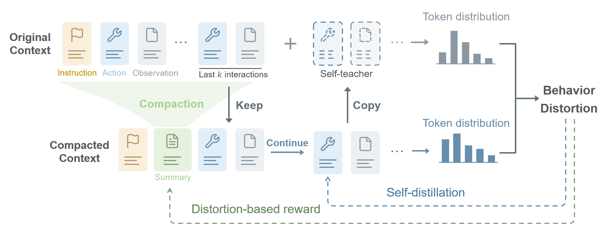

## RECAP: Training Long-horizon LLM Agents with Context Compaction

[Yulun Jiang](https://yljblues.github.io), [Maria Brbić†](https://brbiclab.epfl.ch/team/), [Michael Moor†](https://michaelmoor.me/)

[`Project page`](https://recap-site.github.io) | [`Paper`](paper/recap.pdf) | [`BibTeX`](#citing)

---

This repository contains the source code for **RECAP**, a reinforcement learning framework that jointly trains context compaction and long-horizon LLM agents. RECAP encourages summaries to preserve the behavior induced by the original interaction history, combining a reward for summary generation with self-distillation for subsequent actions and the task-success objective.

The code is a fork of [verl v0.9.0](https://github.com/verl-project/verl/tree/v0.9.0) and supports training on BrowseComp-Plus and SWE-agent.

<br>
<div align="left" style="padding: 0 0pt">

</div>
<br>

## Installation

Reference runtime: Linux, Python 3.12, CUDA 13, PyTorch 2.11.0, vLLM 0.26.0, and Transformers 5.5.3.

1. Set up an FSDP2/vLLM environment following the
   [verl v0.9.0 installation guide](https://github.com/verl-project/verl/blob/v0.9.0/docs/start/install.rst)
   with the reference versions above.

2. From this repository's root, install the RECAP dependencies and Qwen3.5 kernels:

   ```bash
   python -m pip install -r requirements.txt
   MAX_JOBS=8 python -m pip install --no-build-isolation --no-deps \
     flash-attn==2.8.3 causal-conv1d==1.6.2.post1
   ```

## Environment

Follow the corresponding guide to prepare data and configure the environments of [BrowseComp-Plus](scripts/browsecomp_plus/README.md) and [SWE-agent with E2B](scripts/swe_agent/README.md).

## Training

Prepare the data, services, and Ray cluster using the environment guides. The default experiment configuration uses **16 GPUs**: two training nodes and two rollout nodes, with four GPUs per node (`TRAIN_NNODES=2`, `ROLLOUT_NNODES=2`, `GPUS_PER_NODE=4`). BrowseComp-Plus retrieval and judge services use additional GPUs.

To train with RECAP, run from the repository root on the Ray head node:

```bash
# BrowseComp-Plus
bash scripts/browsecomp_plus/train/train.sh

# SWE-agent
bash scripts/swe_agent/train/train.sh
```

To train a task-reward-only GRPO baseline with the same context compaction:

```bash
RECAP_COEF=0 bash scripts/browsecomp_plus/train/train.sh
```

The Slurm launchers are documented in the [BrowseComp-Plus](scripts/browsecomp_plus/README.md#slurm-optional) and [SWE-agent](scripts/swe_agent/README.md#slurm-optional) guides.


## Evaluation

Export a training checkpoint to Hugging Face format, then follow the [BrowseComp-Plus evaluation guide](scripts/browsecomp_plus/README.md) or the [SWE-agent evaluation guide](scripts/swe_agent/README.md). Both guides include checkpoint evaluation and native tool-calling baselines.

## Acknowledgements

This work builds on [verl](https://github.com/verl-project/verl), [BrowseComp-Plus](https://github.com/texttron/BrowseComp-Plus), [SWE-bench](https://github.com/SWE-bench/SWE-bench), and [SDPO](https://github.com/lasgroup/SDPO). We thank their authors and contributors for making their work openly available.

We also thank [Swiss AI](https://github.com/swiss-ai) for its generous support with compute resources and the [E2B for Research](https://e2b.dev/research) program for providing sandbox infrastructure.

[](https://e2b.dev/research)

## Citing

If you use RECAP in your research, please consider citing the paper.

```bibtex
@misc{jiang2026recap,
  title={RECAP: Training Long-horizon LLM Agents with Context Compaction},
  author={Yulun Jiang and Maria Brbic and Michael Moor},
  year={2026},
}
```
